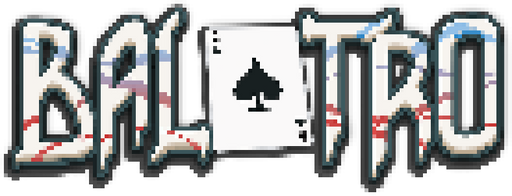
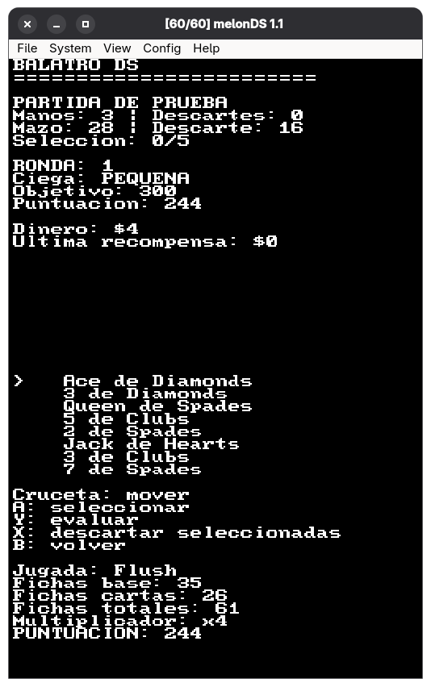
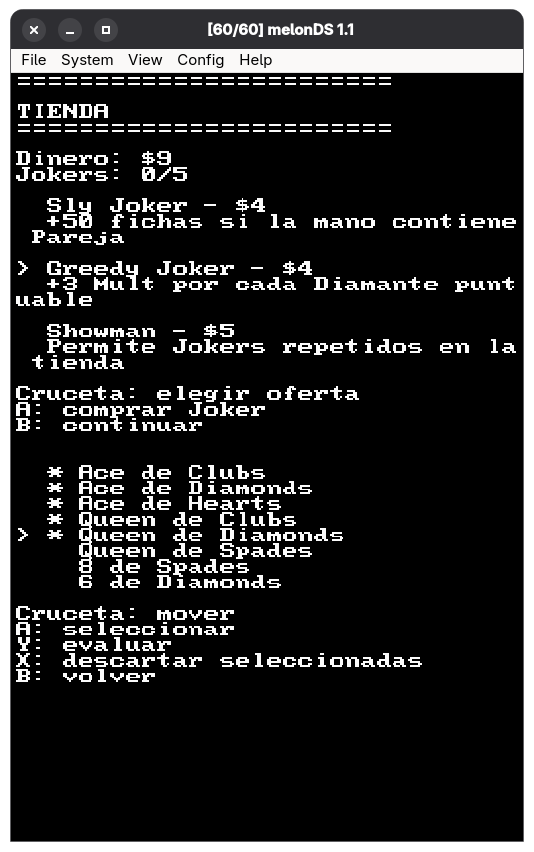
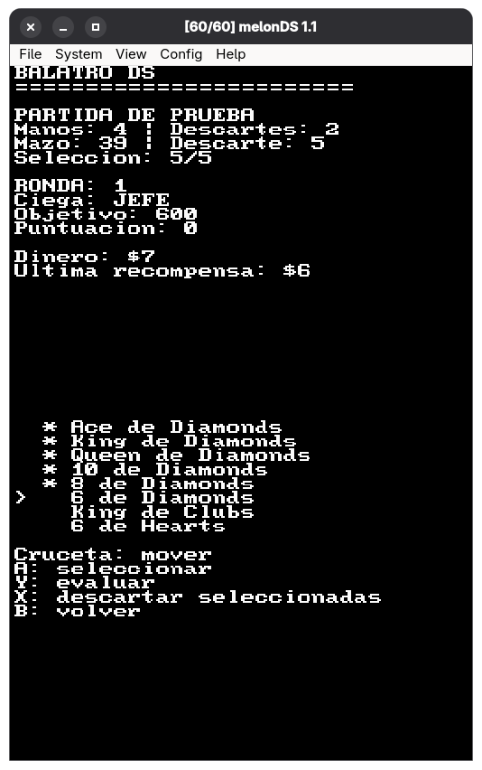

**Idiomas:** [English](readme.md) | Español | [Français](readme.fr.md) | [日本語](readme.ja.md)

  

**Un proyecto no oficial de port homebrew que busca llevar Balatro a Nintendo DS.**

Balatro DS es un proyecto de desarrollo personal y sin fines comerciales, creado para aprender, experimentar y explorar las posibilidades del desarrollo homebrew para Nintendo DS.

El objetivo es recrear la versión original de PC de *Balatro* con la mayor fidelidad posible en el hardware de Nintendo DS, buscando una experiencia de juego 1:1 y adaptando los sistemas, la interfaz y la presentación del juego a las limitaciones de la consola.

Este proyecto se desarrolla de manera independiente y no está afiliado, respaldado ni asociado con los desarrolladores o distribuidores originales de Balatro.

## Objetivos del proyecto

- Recrear las mecánicas principales de juego de la versión original para PC.
- Implementar la evaluación de manos de póker y el sistema de puntuación con la mayor fidelidad posible.
- Reproducir los sistemas de progresión, las rondas y la economía del juego original.
- Adaptar la interfaz y los controles a Nintendo DS.
- Explorar la viabilidad de una experiencia de Balatro de alta fidelidad en hardware original de DS.
- Aprender y mejorar mediante el desarrollo de bajo nivel y la ingeniería inversa del comportamiento del juego.

## Estado actual

**En desarrollo activo — prototipo jugable en una etapa temprana.**

Actualmente, el proyecto es un prototipo básico basado en texto. Estas son algunas de las funciones implementadas:

- Generación y barajado de una baraja estándar de 52 cartas.
- Mano inicial de ocho cartas.
- Navegación y selección de cartas mediante los controles de Nintendo DS.
- Evaluación básica de manos de póker.
- Cálculos iniciales de fichas, multiplicadores y puntuación final.
- Mecánicas básicas para jugar y descartar cartas, incluida la posibilidad de vaciar la mano.

El ciclo principal de juego todavía está incompleto. El desarrollo se centra en construir las bases antes de avanzar hacia una experiencia completa basada en rondas.

  
  
  

### En desarrollo / Planificado

- Ampliación del sistema de comodines (Jokers) con más efectos originales.
- Ofertas aleatorias de comodines en la tienda, con tres comodines disponibles por partida.
- Progresión completa de rondas, ciegas y objetivos de puntuación.
- Límites de manos y descartes.
- Reemplazo de cartas y una mejor gestión del mazo.
- Mecánicas de juego adicionales y mejoras para las cartas.
- Gráficos y animaciones mejorados, junto con una interfaz más fiel y adaptada a las dos pantallas de Nintendo DS.
- Mayor optimización para el hardware de Nintendo DS.

El proyecto se encuentra en una etapa temprana de desarrollo; las funciones y la compatibilidad pueden cambiar a medida que avance.

## Desarrollo

El proyecto está escrito en C y utiliza [BlocksDS](https://blocksds.skylyrac.net/), una plataforma de desarrollo homebrew para Nintendo DS.

El juego original de PC se utiliza como referencia de comportamiento para comprender y reproducir sus mecánicas. Este proyecto no intenta ejecutar directamente el archivo ejecutable original de PC.

## Aviso legal

Balatro pertenece a sus respectivos desarrolladores y titulares de derechos. Este es un proyecto de fans independiente y no oficial, destinado a fines educativos y no comerciales.

Este repositorio no pretende distribuir los recursos ni los archivos propietarios del juego original. Los usuarios deben obtener el juego original y su contenido por medios legítimos.

No se implica ninguna afiliación con los desarrolladores o distribuidores originales, ni su respaldo a este proyecto.

## Contribuciones

Se agradecen las sugerencias, los informes de errores y las conversaciones técnicas. El proyecto sigue siendo experimental y su implementación puede diferir del juego original en muchos aspectos.

## Licencia

La situación de la licencia de este proyecto y de su código original se especificará por separado. Los recursos, el código y demás materiales propietarios de Balatro siguen sujetos a los derechos de sus respectivos titulares.

## Apoyo

Si quieres apoyar el proyecto, ¡adelante! Pero, por favor, apoya primero a los creadores de los proyectos originales (en este caso, LocalThunk).

Sin su apoyo, muchos proyectos como estos —ya sean de pequeños estudios o de aficionados— no serían posibles. ¡Muchas gracias!

  

