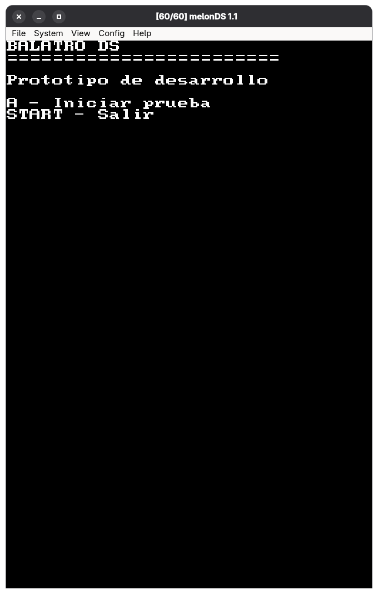
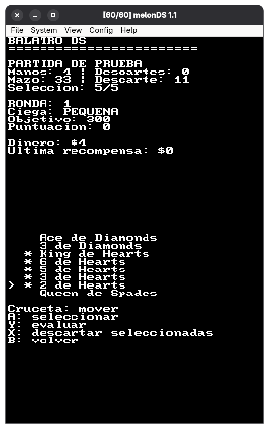

**Langues :** [English](readme.md) | [Español](readme.es.md) | Français | [日本語](readme.ja.md)

  

**Un projet non officiel de portage homebrew visant à adapter Balatro sur Nintendo DS.**

Balatro DS est un projet de développement personnel et non commercial, créé pour apprendre, expérimenter et explorer les possibilités du développement homebrew sur Nintendo DS.

L’objectif est de recréer aussi fidèlement que possible la version PC originale de *Balatro* sur le matériel de la Nintendo DS, en visant une expérience de jeu 1:1 tout en adaptant les systèmes, l’interface et la présentation du jeu aux limites de la console.

Ce projet est développé de manière indépendante et n’est ni affilié aux développeurs ou éditeurs originaux de Balatro, ni approuvé par eux, ni associé à eux.

## Objectifs du projet

- Recréer les principales mécaniques de jeu de la version PC originale.
- Implémenter aussi fidèlement que possible l’évaluation des mains de poker et le système de score.
- Reproduire les systèmes de progression, les manches et l’économie du jeu original.
- Adapter l’interface et les commandes à la Nintendo DS.
- Explorer la faisabilité d’une expérience Balatro très fidèle sur le matériel d’origine de la DS.
- Apprendre et progresser grâce au développement bas niveau et à l’ingénierie inverse du comportement du jeu.

## État actuel

**En développement actif — prototype jouable à un stade précoce.**

Le projet est actuellement un prototype de base reposant sur du texte. Les fonctionnalités suivantes sont implémentées :

- Génération et mélange d’un jeu standard de 52 cartes.
- Main de départ de huit cartes.
- Navigation et sélection des cartes à l’aide des commandes de la Nintendo DS.
- Évaluation élémentaire des mains de poker.
- Premiers calculs des jetons, du multiplicateur et du score final.
- Mécaniques de base pour jouer et défausser des cartes, avec la possibilité de vider entièrement la main.

La boucle de jeu principale est encore incomplète. Le développement se concentre sur la mise en place des bases avant de passer à une expérience complète organisée en manches.

  
  
  

### Fonctionnalités prévues

- Progression des manches, blinds, objectifs de score et conditions de victoire ou de défaite.
- Limites de mains et de défausses.
- Piocher des cartes de remplacement et gérer le paquet entre les coups.
- Jokers, améliorations de cartes et autres mécaniques du jeu.
- Cartes graphiques, animations et interface plus fidèle, adaptée aux deux écrans de la Nintendo DS.
- Optimisations supplémentaires pour le matériel de la Nintendo DS.

Le projet en est encore à ses débuts ; les fonctionnalités et la compatibilité peuvent évoluer au fil du développement.

## Développement

Le projet est écrit en C avec [BlocksDS](https://blocksds.skylyrac.net/), un environnement de développement homebrew pour Nintendo DS.

Le jeu PC original sert de référence comportementale pour comprendre et reproduire ses mécaniques. Ce projet ne cherche pas à exécuter directement le fichier exécutable original pour PC.

## Avertissement

Balatro appartient à ses développeurs et ayants droit respectifs. Il s’agit d’un projet de fans indépendant et non officiel, destiné à des fins éducatives et non commerciales.

Ce dépôt n’a pas pour objectif de distribuer les ressources ou fichiers propriétaires du jeu original. Les utilisateurs doivent obtenir le jeu original et son contenu par des moyens légitimes.

Aucune affiliation avec les développeurs ou éditeurs originaux, ni aucune approbation de leur part, n’est sous-entendue.

## Contributions

Les suggestions, rapports de bogues et échanges techniques sont les bienvenus. Le projet reste expérimental et son implémentation peut différer du jeu original sur de nombreux points.

## Licence

Le statut de licence de ce projet et de son code original sera précisé séparément. Les ressources, le code et les autres éléments propriétaires de Balatro restent soumis aux droits de leurs ayants droit respectifs.

## Soutenir le projet

Si vous souhaitez soutenir ce projet, vous le pouvez — mais, s’il vous plaît, soutenez d’abord les créateurs des projets originaux (dans ce cas, LocalThunk).

Sans leur soutien, de nombreux projets de ce type, qu’ils viennent de petits studios ou de passionnés, ne seraient pas possibles. Merci beaucoup !

  

